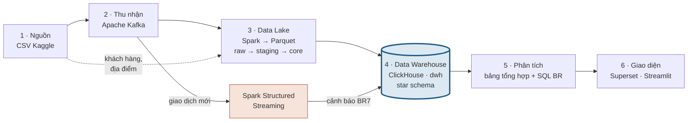

> **Lưu trữ:** README của Phase 1, chuyển khỏi thư mục gốc ngày 22/10/2026. Các đường dẫn bên dưới theo cấu trúc repo Phase 1; xem đúng trạng thái đó bằng `git checkout phase1-kaggle`.

<div align="center">

# 🏦 BankDW — Banking Data Warehouse

**Kho dữ liệu ngân hàng theo mô hình Kimball, từ file CSV đến dashboard và cảnh báo realtime**

Đồ án môn Data Engineering (CO5173) · HCMUT · HK1 2026–2027 · Nhóm 27


</div>

---

> **🚧 Phase 2 đang triển khai (từ 22/10/2026):** dữ liệu **Berka**, kiến trúc A–F theo sheet nhóm chốt ngày 18/10 — xem [docs/PLAN_PHASE2.md](docs/PLAN_PHASE2.md) và [CHANGELOG.md](CHANGELOG.md). Nội dung bên dưới mô tả **Phase 1** (Kaggle), đã lưu ở tag `phase1-kaggle` và thư mục [archive/phase1](archive/phase1/).

## 📌 Giới thiệu

Dự án xây dựng một **data warehouse theo mô hình Kimball** cho dữ liệu giao dịch ngân hàng (bộ [Banking Data Warehouse Sample](https://www.kaggle.com/datasets/eserkaraceper/banking-data-warehouse-sample) trên Kaggle: 1,4 triệu giao dịch, 1 triệu khách hàng, Ấn Độ, 2016), nhằm trả lời **10 yêu cầu nghiệp vụ (BR)** cho 7 nhóm người dùng qua dashboard và trang cảnh báo realtime.

**Kết quả chính**

- ✅ 10/10 BR demo được end-to-end (7 dashboard Superset + 1 trang Streamlit)
- ✅ 12/12 kiểm tra chất lượng dữ liệu đạt, tổng tiền đối soát lệch 0,00 INR
- ⚡ Cảnh báo giao dịch bất thường hiện trên màn hình sau ~2–3 giây (p95 3,0 s)
- 📊 Benchmark: ClickHouse nhanh hơn PostgreSQL 2,4–36× trên cùng star schema

## 🏗️ Kiến trúc



| Lớp | Lưu ở đâu | Trạng thái |
|---|---|---|
| Nguồn | `data/` (CSV) | Thô, bản gốc |
| Kafka | topic `transactions` | Thô, giả lập luồng giao dịch bằng `producer.py` |
| Data Lake | `lake/raw` → `lake/staging` → `lake/core` (Parquet) | Thô → đã sửa lỗi → star schema |
| **Data Warehouse** | **ClickHouse, database `dwh`** | **Bản chính thức, mọi báo cáo đọc từ đây** |
| Phân tích | ClickHouse `mart`, `dq` + `warehouse/queries/` | Tính ra từ `dwh` |
| Giao diện | Superset, Streamlit | Chỉ hiển thị, truy vấn thẳng ClickHouse |

Giải thích chi tiết từng chặng: mở [docs/architecture.html](docs/architecture.html) bằng trình duyệt.

### Star schema (`dwh`)

| Fact (data mart) | dim_date | dim_customer | dim_location | dim_transaction_type |
|---|:-:|:-:|:-:|:-:|
| `fact_transactions` — mỗi dòng 1 giao dịch | ✓ | ✓ | ✓ | ✓ |
| `fact_customer_balance_snapshot` — số dư cuối tháng | ✓ | ✓ | | |
| `fact_transaction_alert` — cảnh báo realtime (BR7) | ✓ | ✓ | ✓ | |

## 🎯 Yêu cầu nghiệp vụ

| BR | Nhóm người dùng | Câu hỏi | Xem ở |
|---|---|---|---|
| BR1 | Ban điều hành | Số giao dịch, giá trị, khách hoạt động theo ngày/tuần/tháng | Executive Overview |
| BR2 | Ban điều hành | Ngày thường so với cuối tuần, theo thứ | Executive Overview |
| BR3 | Quản lý khu vực | Xếp hạng thành phố theo giá trị giao dịch | Regional Performance |
| BR4 | Marketing/CRM | Phân khúc khách RFM | Marketing & CRM |
| BR5 | Marketing/CRM | Chi tiêu theo nhóm tuổi × giới tính | Marketing & CRM |
| BR6 | Phát triển sản phẩm | Cơ cấu loại giao dịch theo khu vực | Product Usage |
| BR7 | Quản trị rủi ro | Cảnh báo giao dịch bất thường gần realtime | Streamlit + Risk Alerts |
| BR8 | Quản lý tài sản | Khách số dư top 1% để cross-sell | Wealth Management |
| BR9 | Nhóm dữ liệu | Chất lượng dữ liệu | Data Quality |
| BR10 | Quản lý khu vực | Phân bố giá trị theo dải tiền và khu vực | Regional Performance |

## 🚀 Hướng dẫn chạy

### 1. Chuẩn bị

- **Docker Desktop** với ít nhất **8 GB RAM** cho Docker (Settings → Resources)
- `make` (có sẵn trên macOS/Linux)
- Khoảng 5 GB đĩa trống

### 2. Tải dữ liệu và cấu hình

```bash
git clone <repo-url> data-bank
cd data-bank
```

Tải bộ dữ liệu từ [Kaggle](https://www.kaggle.com/datasets/eserkaraceper/banking-data-warehouse-sample), giải nén sao cho có cấu trúc:

```
data/
└── dwh/
    ├── fact_transactions.csv
    ├── dim_customer.csv
    └── dim_location.csv
```

Tạo file `.env` cho Superset, rồi sửa mật khẩu và secret key:

```bash
cp .env.example .env
```

### 3. Dựng hạ tầng

Khởi động Kafka, ClickHouse, Spark và tạo topic `transactions`:

```bash
make up
```

Kiểm tra mọi service đều trả lời:

```bash
make smoke
```

### 4. Chạy pipeline batch

Phát toàn bộ giao dịch vào Kafka (chỉ cần một lần, ~5 giây):

```bash
make produce
```

Chạy ingest → làm sạch → dựng star schema → nạp ClickHouse → kiểm tra chất lượng → tổng hợp và truy vấn BR (~1 phút):

```bash
make pipeline
```

### 5. Mở giao diện

```bash
make app-up
```

Lần đầu tiên, tạo kết nối, dataset, dashboard và role trong Superset:

```bash
make app-bootstrap
```

| Ứng dụng | Địa chỉ | Đăng nhập |
|---|---|---|
| Superset | http://localhost:8088 | Tài khoản trong `.env` |
| Streamlit | http://localhost:8501 | Không cần |
| ClickHouse (HTTP) | http://localhost:8123 | `bank` / `bank` |

### 6. Demo cảnh báo realtime (BR7)

Xoá cảnh báo cũ và bật stream:

```bash
make stream-reset
```

```bash
make stream
```

Đợi vài giây cho stream nạp xong bảng tra cứu, rồi phát giao dịch có nhịp (ví dụ 40.000 giao dịch, 2.000 giao dịch/giây):

```bash
make produce-live RATE=2000 LIMIT=40000 SKIP=100000
```

Mở Streamlit để xem cảnh báo xuất hiện. Mỗi lần demo nên dùng `SKIP` khác nhau để không bị cảnh báo trùng.

```bash
make stream-stop
```

### ☁️ Dùng ClickHouse trên cloud (Aiven) thay cho local

Mặc định ClickHouse chạy trong container trên máy. Muốn cả nhóm dùng chung một ClickHouse trên cloud:

1. Tạo service **Aiven for ClickHouse** (bản dùng thử), mở tab *Connection information* → *ClickHouse HTTPS & JDBC*.
2. Điền vào `.env` (mẫu ở `.env.example`):
   ```
   CLICKHOUSE_HOST=<host>.aivencloud.com
   CLICKHOUSE_PORT=<port>
   CLICKHOUSE_USER=avnadmin
   CLICKHOUSE_PASSWORD=<password>
   CLICKHOUSE_SECURE=true
   CLICKHOUSE_DATABASE_ENGINE=Replicated
   ```
3. Chạy các bước 3–6 như bình thường. Container ClickHouse local sẽ không được bật; `make load` gửi file Parquet lên cloud qua HTTPS; các database `dwh`, `mart`, `dq` được tạo tự động.

Muốn quay về local: xoá (hoặc comment) các dòng `CLICKHOUSE_*` trong `.env`. Kiểm tra đang dùng ClickHouse nào: `make smoke`. Chạy nhanh một câu SQL: `make sql Q="SELECT count() FROM dwh.fact_transactions"`.

> Benchmark (bước 7) chỉ chạy với ClickHouse local.

### 7. Benchmark (tuỳ chọn)

So sánh star schema trên ClickHouse với One Big Table và PostgreSQL. Tắt Superset, Streamlit và stream trước khi đo.

```bash
docker compose --profile bench up -d --wait postgres
```

```bash
docker compose exec -T spark spark-submit /opt/benchmark/spark_build_obt.py
```

```bash
docker compose exec -T spark python3 /opt/benchmark/build_obt.py
```

```bash
bash benchmark/load_postgres.sh
```

```bash
docker compose exec -T spark python3 /opt/benchmark/run_queries.py
```

Kết quả thô ở `lake/bench/results/`, tóm tắt ở [docs/BENCHMARK.md](docs/BENCHMARK.md).

### Dừng và dọn dẹp

| Lệnh | Tác dụng |
|---|---|
| `make app-down` | Dừng Superset và Streamlit |
| `make down` | Dừng toàn bộ, giữ dữ liệu ClickHouse |
| `make clean` | ⚠️ Xoá hết: container, volume ClickHouse/Kafka và thư mục `lake/` |

## 🧰 Các lệnh `make`

| Lệnh | Giai đoạn | Việc làm |
|---|---|---|
| `make up` / `make down` | P0 | Bật / tắt Kafka, ClickHouse, Spark |
| `make smoke` | P0 | Kiểm tra các service |
| `make produce` | P1 | Phát toàn bộ giao dịch vào Kafka |
| `make ingest` | P1 | Kafka + CSV → `lake/raw` |
| `make core` | P2 | raw → staging → core (star schema) |
| `make load` | P2 | core → ClickHouse `dwh` |
| `make dq` | P2 | 12 kiểm tra chất lượng → `dq.audit` |
| `make marts` | P3 | Bảng tổng hợp RFM + chạy 10 truy vấn BR |
| `make pipeline` | P1–P3 | `ingest` → `core` → `load` → `dq` → `marts` |
| `make stream` / `stream-stop` / `stream-reset` / `stream-logs` | P4 | Điều khiển luồng cảnh báo realtime |
| `make produce-live RATE= LIMIT= SKIP=` | P4 | Phát giao dịch có nhịp để demo |
| `make app-up` / `app-down` / `app-bootstrap` | P5 | Superset và Streamlit |
| `make sql Q="..."` | — | Chạy một câu SQL trên ClickHouse đang cấu hình (local hoặc cloud) |

## 📁 Cấu trúc thư mục

```
data-bank/
├── apps/             # Giao diện: superset/ (cấu hình + script dựng dashboard), streamlit/ (trang cảnh báo)
├── benchmark/        # P6: script và truy vấn so sánh với One Big Table, PostgreSQL
├── data/             # CSV gốc từ Kaggle (không đưa lên git)
├── docs/             # architecture.html, PLAN.md, requirement.md, BENCHMARK.md
├── ingestion/        # producer.py: đọc CSV, phát giao dịch vào Kafka
├── lake/             # Parquet sinh ra khi chạy: raw/, staging/, core/ (không đưa lên git)
├── report/           # Report IEEE (main.tex)
├── spark/            # Dockerfile + jobs/: ingest, làm sạch, star schema, nạp, DQ, streaming
├── warehouse/
│   ├── clickhouse/   # init/ (tạo database), ddl/ (tạo bảng)
│   ├── postgres/     # Schema cho benchmark
│   ├── queries/      # 10 file SQL cho BR1–BR10
│   └── seeds/        # city_mapping.csv: chuẩn hoá tên thành phố
├── docker-compose.yml
├── Makefile
└── CHANGELOG.md      # Nhật ký quyết định và phát hiện
```

## 📚 Tài liệu

- [docs/architecture.html](docs/architecture.html) — sơ đồ và giải thích luồng dữ liệu
- [docs/PLAN.md](docs/PLAN.md) — kế hoạch, phân công, giai đoạn
- [docs/requirement.md](docs/requirement.md) — tóm tắt yêu cầu đồ án
- [docs/BENCHMARK.md](docs/BENCHMARK.md) — phương pháp và kết quả benchmark
- [CHANGELOG.md](CHANGELOG.md) — các quyết định thiết kế và phát hiện về dữ liệu

## 👥 Nhóm 27

| Thành viên | Mảng phụ trách | BR |
|---|---|---|
| Nguyễn Hồ Tuấn Kiệt | Hạ tầng, Kafka, producer, streaming | BR7, BR9 |
| Trần Minh Quân | Spark ETL, mô hình Kimball, data quality | BR4, BR8 |
| Huỳnh Ngọc Văn | ClickHouse, dashboard Superset | BR1, BR2, BR3 |
| Hồ Ngọc Hải | Phương án thay thế, benchmark, đánh giá | BR5, BR6, BR10 |
