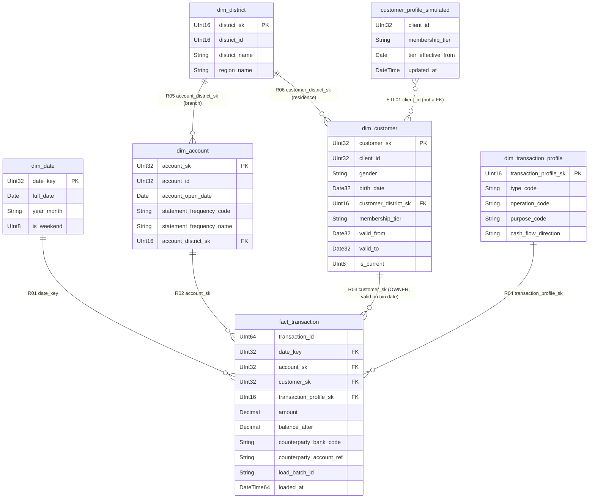

# Mô hình dữ liệu Phase 2 — vật lý

Cột, grain và quy tắc lấy từ sheet *Data Dictionary* (chốt 18/10/2026). File này ghi phần sheet còn để mở: **kiểu vật lý** và cách hiện thực trên ClickHouse / PostgreSQL.
DDL: [warehouse/clickhouse/ddl/dw.sql](../warehouse/clickhouse/ddl/dw.sql), [warehouse/postgres/ddl/ops.sql](../warehouse/postgres/ddl/ops.sql). Tạo và kiểm tra: `make schema`.

## 1. ERD — Data Warehouse (ClickHouse, database `dw`)

`dim_district` dùng **2 vai trò** (khu vực chi nhánh qua `dim_account`, khu vực cư trú qua `dim_customer`), không nối thẳng fact; hai khu vực có thể khác nhau (409 tài khoản).

## 2. Quyết định vật lý (ClickHouse)

| Vấn đề | Cách làm | Lý do |
|---|---|---|
| PK/FK | Chỉ là quan hệ logic; pipeline kiểm tra khóa trước khi công bố | ClickHouse không ép ràng buộc (sheet, ghi chú ERD) |
| Sửa Type 1, đóng phiên bản SCD2 | `ReplacingMergeTree(updated_at)`: ghi **dòng mới** cùng khóa, `updated_at` mới hơn; đọc bằng `FINAL` | ClickHouse không có UPDATE tại chỗ; dimension nhỏ nên `FINAL` rẻ |
| Mốc "hiện tại" của SCD2 | `valid_to = 2299-12-31` (`Date32`) | Sheet ghi mốc logic 9999-12-31, nhưng giới hạn của `Date32` là 2299-12-31 (Q-J) |
| Ngày sinh trước 1970 | `birth_date Date32` | `Date` chỉ từ 1970 |
| Chạy lại cùng lô không nhân đôi | Pipeline bỏ qua `transaction_id` đã có; thêm `ReplacingMergeTree(loaded_at)` làm lưới an toàn | Sheet L05, N05 |
| Sắp xếp và phân vùng fact | `ORDER BY (account_sk, date_key, transaction_id)`, `PARTITION BY` năm | BR02 lọc theo tài khoản + kỳ; BR01 lọc theo kỳ |
| Số tiền | `Decimal(18, 2)` | Không sai số khi đối chiếu tiền vào/ra với nguồn |

## 3. Kho vận hành (PostgreSQL, schema `ops`)

| Bảng | BR | Nội dung |
|---|---|---|
| `batch` | BR06 | Lô đầu vào (lịch sử theo tháng hoặc kịch bản KB), đường dẫn bản chụp trong Data Lake |
| `pipeline_run`, `pipeline_step` | BR06 | Mỗi lần chạy / chạy lại và từng bước: trạng thái, thời gian, số nhận / đạt / lỗi, bước thất bại, nguyên nhân |
| `dq_rule`, `rejected_record` | BR05 | Quy tắc V1–V6; bản ghi bị tách kèm mã quy tắc, lý do và nội dung gốc (`jsonb`) |
| `alert_rule`, `alert` | BR03 | Quy tắc R1, R2; cảnh báo kèm lý do, căn cứ (`evidence`), giao dịch liên quan; **duy nhất theo (tài khoản, quy tắc, kỳ)** để chống trùng |
| `alert_action` | BR04 | Lịch sử chuyển trạng thái `NEW` (chưa xem) → `IN_REVIEW` (đang xem xét) → `RESOLVED` (đã xử lý) và ghi chú |
| `backup_catalog`, `backup_operation` | BR07 | Danh mục bản sao lưu trên ổ `backups` của ClickHouse, số liệu đối chiếu, kết quả từng lần sao lưu / khôi phục |

PostgreSQL có PK, FK, CHECK thật. Theo sheet, PostgreSQL **nằm ngoài phạm vi sao lưu BR07** và không chứa dữ liệu kho.
